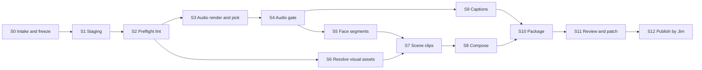

---
title: Diary pipeline spec
status: v0.3 (v0.2 approved; locked-in approach 2026-11-13)
created: 2026-11-13
updated: 2026-11-13
owner: Jim
tags: [diary, pipeline, spec, workstream-C]
---
> **2026-11-16 NOTE:** the brokkr orchestrator / SadTalker / XTTS design below is SUPERSEDED. Current stack and state are in STATUS-C.md (section '2026-11-16 CURRENT STATE') and LAB-LOG.md. Kept for history.


# Diary pipeline spec (v0.3)

Related: [[Diary/Vision]] · [[Diary/README-C-pipeline]] (current implementation) · [[Diary/STATUS-C]] · [[Diary/C-tasks]] · [[Diary/Credits]] · [[Hub/diary-tasks]]

> **Changelog v0.3 (2026-11-13 audit).** Approach locked in by Jim. Since v0.2: orchestrator v0 built (`pipeline/orch.py`, queue, ledger, flock lock, STOP file, content-keyed job dirs; see `pipeline/README-v0.md`); pick script v2 fixes empty-expected-text IndexError; Ep1 opens event-first (outbreak of war + newsreel, then original opening), Ep1 ends at end of year, Ep1/Ep2 boundary moved into page 2-6; layout prototypes `full` and `side` exist (`tools/c_proto_layout.py`), smooth scroll via 4x supersampling; three text forms per chunk (source/caption/spoken) with Lexicon corrections; adaptive takes designed (not built). **§13 dispositions now:** `c_loki_ep_loop.ps1` and `c_brokkr_ep_job.sh` retired (archived, replaced by orch.py); `c_brokkr_episode*.sh/_render/_pick` still in use via `ep_audio.sh`. **§14:** event-first = decided; portrait/layout = pending Jim's clip review; backup target = open (NAS and/or brokkr proposed). Still open: cross-language alignment, credits on screen, AWAY switch, loudness/music, thumbnail, ssh key policy.

> [!info] Legend
> **R#** = requirement from Jim (2026-11-13 notes). **D#** = requirement derived from the review (Claude's, for Jim to accept or drop). ⚠ = assumption or extrapolation, not verified. ❓ = open decision for Jim.

## 1. Purpose and scope
Turn the text of one journal episode into an upload-ready bilingual (PL, EN) YouTube package: video, title, description, chapters, subtitles for both languages. Build the **building blocks** reliably first; then run them for all episodes.

- **In scope:** text staging, audio (XTTS + Whisper QA), face lip-sync (SadTalker), scene rendering, episode composition, captions, packaging, review-and-patch.
- **Out of scope here:** archival sourcing (Workstream B), Notebook 2 transcription (Workstream A), actual upload and publishing (Jim confirms each). Both feed this pipeline through the contracts in section 4.
- **Dates:** soft 2026-12-15, hard 2026-12-24 ~19:00. Premiere = Eps 1-4 in PL and EN; Eps 5-16 weekly from early Jan 2027; Notebook 2 later.

## 2. Requirements
| ID | Requirement | Source |
|---|---|---|
| R1 | Conserve tokens: reusable scripts and local compute by default; AI only where judgment is needed | Jim |
| R2 | Retain and catalogue every intermediate artifact; fix a glitch by redoing only the glitched part and reassembling | Jim |
| R3 | Resilient to Claude outages, connectivity loss, power loss; granular work, regular logging; interrupted set identifiable from planned vs completed; resume without redoing finished work | Jim |
| R4 | Real-time monitoring without interrupting work: done, in progress, next step per item | Jim |
| R5 | CI/CD-style: one run builds a full episode when prerequisites are met; adjustments made up front, not mid-build | Jim |
| R6 | Start: text scoped to the episode. End: video ready for YouTube with title, description, PL and EN subtitles | Jim |
| R7 | Jim previews segments and reviews finished episodes; no repeated whole-episode iterations | Jim |
| R8 | Tools validated on a small sample of the material before mass production | Jim |
| R9 | Each episode driven by an elaborated storyboard of scenes (title scene first; text; staging: face, images, clips) | Jim |
| R10 | Text staged to pass the ear test: rate, pauses, max sentence length, pronunciation of numbers, dates, names | Jim |
| R11 | Audio per sentence (2 sentences or a split where staging demands); multiple takes; Whisper QA; best take chosen | Jim |
| R12 | Face animation only for scenes that call for it | Jim |
| R13 | Assembly per [[Diary/Vision]] (framing, palette, transitions, movement) | Jim |
| R14 | Track activity and share information as md files; view in Obsidian rooted at `Claude/Projects` | Jim |
| R15 | Episodes are built from independent **scenes**: a scene is produced as soon as its inputs are ready; the episode assembles when all scenes are ready | Jim 2026-11-13 |
| R16 | **No hard cuts**: transitions are dissolves or fades, and audio (voice, music bed, archival audio) joins gracefully across scenes | Jim 2026-11-13 |
| D1 | Three text forms per chunk: **source** (verbatim, never edited), **caption** (source with orthography corrected, per subtitle convention), **spoken** (what TTS reads) | Claude; convention agreed by Jim 2026-11-13 |
| D2 | Single-writer locks per resource, so two workers can never run the same job (the 2026-11-13 duplicate loops) | Claude |
| D3 | Recipes (voice, deepen, tempo, gaps, face settings) are versioned and frozen before mass production; stamped in every manifest | Claude; agreed by Jim 2026-11-13 (no mid-production tweaks) |
| D4 | Timestamp-to-artifact lookup so a review note ("ep1 PL 12:34") maps to one chunk and one scene | Claude |
| D5 | Missing archival assets never block a build: each landmark has a declared fallback | Claude |
| D6 | Loki yields to Jim: an AWAY switch gates GPU jobs | Jim (earlier), Claude (spec) |
| D7 | Artifact store backed up off both machines (single copies today) | Claude |
| D8 | Acceptance criteria and QC gates defined per stage before first use | Claude |

## 3. Overview

**Gates (human):** S1 (staging approved once), S4 (audio: flagged items only), S11 (finished episode). Everything else runs unattended.

## 4. Data model
### 4.1 Input contract (what an episode needs)
- Verified text for the episode's page range (Notebook 1: `Text\PL`, `Text\EN`; Notebook 2 later, same shape) plus page images and dates.
- Source text is **never edited** by the pipeline. Its hash is recorded at S0; a changed hash invalidates everything downstream of the changed chunk only.

### 4.2 Episode spec: `Episodes\NN-Title\episode.yaml`
Written once at S1 (AI-assisted draft, Jim approves), then frozen.
```yaml
episode: 1
recipes: {audio_pl: v1, audio_en: v1, face: v1, look: v1}   # see 4.6
languages: [pl, en]
opening: standard          # standard | event_first (event image first, then the usual pattern)
scenes:
  - id: e01-s01
    type: narration        # narration | landmark | interlude | outro
    pages: ["1-2"]
    chunks: "1-2:0..10"    # sentence range, exact cover, no overlap
    face: {on: true, portrait: WA0003, layout: face_first}
    journal: {pan: top_to_bottom, jx: 400}
    overlay: {title: true, summary: true, hold_s: 6}
    transition_out: {type: dissolve, dur_s: 1.0}
  - id: e01-s02
    type: landmark
    chunks: "1-3:0..4"
    assets: [{id: E1-L2, fallback: journal_only, side: right}]
    division: {to: 0.35}   # moving division target
```
### 4.3 Chunk record (one per sentence or merged pair)
`chunk_id` = `e01-pl-1-2-004`. Fields: `source_text` (verbatim typed text, never edited), `caption_text` (what captions show: source with orthography corrected), `spoken_text` (what XTTS reads, from the corrected form: numbers spelled out, pacing commas, respellings), `lexicon_hits`, `merge/split` flags, `paragraph`, takes, picked take, ASR text, word errors, **start_s / end_s in the final timeline** (⚠ must be rescaled after the tempo and deepen filter; not stored today).

### 4.4 Artifact store and ledger
- Store layout: `<store>\<kind>\<key>\...` with `kind` in {take, pick, audio_final, face_seg, scene_clip, caption, package}.
- **Key** = hash of everything that determines the artifact, e.g. take = (spoken_text, latent, recipe_version, seed, take_no, model_version); face_seg = (audio slice hash, portrait, SadTalker version, size, preprocess).
- Same key = same artifact, reused. Changed input = new key = only that artifact (and what depends on it) rebuilds. Old artifacts are kept, never overwritten.
- **Ledger** = append-only `ledger.jsonl`: `planned | started | heartbeat | finished | failed | invalidated`, with job id, worker, key, seconds. Writes are atomic (temp file, then rename); partial outputs live in a per-job temp dir.
- `plan.json` enumerates every job for an episode at S2. **Planned vs completed = plan minus finished artifacts.** An interrupted job is one with `started` and no `finished`; it is requeued and its temp dir discarded.

### 4.5 Lexicon and staging rules (persistent, grows each episode)
`Lexicon\pl.tsv`, `Lexicon\en.tsv` (Spoken=Written, with who decided and when), `Lexicon\corrections-pl.tsv` (orthography corrections, Jim-approved) and `Diary\staging-rules.md` (rate, pause values, max sentence length 224 pl / 250 en, comma rules, number and date rules). Ep1 is where these are discovered; later episodes inherit them (R10).

### 4.6 Recipes (frozen before mass production)
| Recipe | Current values |
|---|---|
| audio_pl | latent `c_Kumar65_Ilkin35_80_Damien20`, deepen -1.0 st, bass +2 dB, tempo 1.05, gaps 0.3 / 0.7 s |
| audio_en | same latent, no deepen, tempo 1.0, gaps 0.5 / 1.0 s |
| face | SadTalker (patched), size 256, preprocess full; portrait per scene |
| look | sepia, grain 12, zoom 1.6, period band-limit on voice (per [[Diary/Vision]]) |

## 5. Stages
| Stage | Input | Output | QC gate (⚠ thresholds TBD from the sample) | AI needed? |
|---|---|---|---|---|
| S0 Intake and freeze | page text, images | source hashes, chunk map | text present for every page; hashes recorded | no |
| S1 Staging | storyboard prose, text, lexicon | `episode.yaml`, spoken text, new lexicon entries | **Jim approves once** | **yes** (bounded; the main token spend) |
| S2 Preflight lint | episode.yaml, assets, hosts | pass/fail list, `plan.json` | see 5.1 | no |
| S3 Audio render and pick | spoken text, recipe | picked chunk audio, final page audio, manifest with offsets | clean-take rate; no trailing words; pace band | no |
| S4 Audio gate | manifests, flags | review sheet; accepted or retake list | Jim listens to flagged items, hand-split pages, new names | Jim, not AI |
| S5 Face segments | audio slice, portrait | face clip per face-on range | frame count = audio; face found; no frozen frames; decodes | no |
| S6 Resolve visuals | scene asset ids, `Archival-Images` | resolved files or fallbacks, credits per scene | every landmark resolved or falls back | no |
| S7 Scene clips | audio, face, images, spec | one mp4 per scene, with fade handles | durations match; A/V delta small | no |
| S8 Compose | scene clips, timeline | episode mp4 (per language) | stream sanity; black frames only where intended | no |
| S9 Captions | chunk offsets, caption text | `.srt` per language and track | line length, min/max duration, no overlap | alignment exceptions only |
| S10 Package | episode, captions, credits | title, description, chapters, thumbnail, files | all fields present; credits match assets used | no |
| S11 Review and patch | episode, timeline lookup | accepted, or patch list | Jim | Jim |
| S12 Publish | package | scheduled upload | **Jim's go for each** | no |

### 5.1 Preflight lint (fails before any compute, R5)
Source hash unchanged; no digits in spoken text; every sentence within the char limit; chunks cover the text exactly once; unknown names not in the lexicon; scenes cover all chunks; every landmark resolved or has a fallback; portrait set for every face-on scene; recipes frozen; brokkr reachable; GPU memory free; disk space; tool versions match the pins.

### 5.2 S3 audio: escalation ladder (replaces a model feedback loop)
Whisper reports *what it heard*, not how to change the voice. ⚠ As far as I know XTTS-v2's levers are text, seed and sampling settings (temperature and similar). So:
1. Render 2-3 takes; ASR them; stop when one is clean.
2. If none clean: more takes with varied sampling settings.
3. If still none: lexicon respelling, or merge or split the chunk.
4. If still none: flag for Jim's ear (S4).
Takes per chunk become adaptive (today: fixed 8, with Whisper about 80% of compute). Gain is untested; the sample (section 9) measures it.

### 5.3 S5 faces: sparing and segment-level
Face-on ranges come from the scene spec (episode intro and outro, scene changes, key points without imagery, per Vision). Each range renders as its own segment, keyed by audio slice, so one changed sentence re-renders only its segment. Portrait is a per-scene field, so either plan works: younger for the bulk and older toward the end, or older predominant. ❓ pending the comparison.

### 5.4 Scenes, readiness and compose
- A scene is **ready** when its inputs resolve (audio accepted at S4, face segments if face-on, assets or fallbacks). A ready scene renders at once (S7), independent of the others. When every scene is rendered, S8 composes the episode.
- Scene clips carry **handles** (extra frames and audio at both ends, equal to the transition length), so transitions are applied at compose without re-rendering scenes.
- ⚠ Compose re-encodes the whole episode (dissolves cannot be stream-copied). I expect minutes, not hours, for 20-25 min of video, against hours for faces. Patching one scene = re-render that scene, re-compose.
- Journal pan is a pure function of (page, time), so a clip re-renders independently and stays continuous across scenes.

### 5.5 Transitions and audio continuity (R16)
- **No hard cuts.** Every scene boundary names a transition in the spec (default: dissolve 1.0 s; fade through black for major events, per [[Diary/Vision]]).
- Audio: voice tails and music overlap across the boundary (crossfade, about 1 s default). A **music bed** or archival-audio piece is an episode-level layer placed on the timeline (start scene, end scene) with ducking under voice, so it runs across scene joins instead of restarting per scene.
- Loudness is normalised at compose so scenes match. ❓ Target level, and music and archival audio sources, not chosen yet.

### 5.6 Intro
- **Episode 1 (special handling, Jim 2026-11-13):** the grandfather's face first, half frame; the journal page fills the other half as he begins speaking; title and summary overlay the journal briefly while it scrolls or moves to the next page.
- **Episodes 2+ (Jim 2026-11-13):** same pattern. The grandfather fades in, the journal page we are on follows quickly, he begins speaking, and the overlay shows the **episode title, a short topic, the date range and the journal page range** (Ep1 adds the series title).
- **Exception, `opening: event_first`:** if the episode opens with or focuses on a major world event, an image tied to that event is shown first with the title information, then the usual pattern resumes. Set per episode at S1. ❓ Which episodes qualify (by title alone, Ep3, Ep4 and Ep11 look like candidates; ⚠ not checked against the text).
- Throughout: fades between the grandfather, the journal and archival imagery and clips, per [[Diary/Vision]]. ⚠ Vision steps 1-2 should be updated to match; I have not edited that file.

## 6. Resilience
- Every job is **idempotent** and writes only to its own temp dir, then renames.
- **Locks (D2):** one lock per resource (brokkr GPU 0 ASR, GPU 1 TTS, loki GPU) with PID and heartbeat; stale locks are reclaimed; a second worker exits.
- **Workers start from Task Scheduler**, not from a Claude session (last night's run died on an app update). Nothing at run time needs Claude or the network beyond ssh between loki and brokkr.
- **Classify failures:** deterministic (text too long) = fail at preflight, never retry; transient (ssh, GPU out of memory) = backoff and retry; quality (no clean take) = ladder, then flag.
- **Resume** = rerun the same command; the ledger and store decide what is left.
- **Power:** workers start on boot (loki: Task Scheduler at startup; brokkr: ⚠ no sudo, so cron `@reboot` or a user service, to be checked). Jim plans to move both machines to a UPS once the pipeline is built and tested; ⚠ do it between runs and use the downtime as the power-loss resume test (section 9).
- **Backup (D7):** nightly copy of the store (not scratch) to a second location, ❓ NAS target; ties to the household-backups effort.

## 7. Monitoring (R4)
- Each worker appends to `ledger.jsonl`; a small generator rewrites `Diary\STATUS-PIPELINE.md` (Obsidian-readable) every few minutes and at each job end:
  - an episode × stage matrix (done / running / queued / failed / needs Jim),
  - current job per worker with ETA from measured s per audio second,
  - next step for each completed item,
  - the flag list (needs-ear, failed, stale locks).
- Readable with zero tokens. ⚠ Loki pulls state from brokkr (loki already initiates ssh) and writes the md into `Claude\Projects`.

## 8. Compute scheduling and the AWAY switch
- **brokkr:** GPU 1 TTS, GPU 0 ASR, concurrent. ⚠ ASR was measured CPU-bound, so concurrency gain is unmeasured.
- **loki:** one GPU, **one SadTalker process at a time**. WA0005 costs about 8.8 s per audio second against about 2.3 for WA0003 when alone (measured 2026-11-13), so portrait choice drives face cost.
- **AWAY switch:** ❓ mechanism (a flag file toggled by a small script). Present = loki GPU jobs may start; absent = no new GPU jobs, finish the current one.

## 9. Validation before mass production (R8)
**Sample set** (seeded, recorded): about 8 random chunks per language drawn from across all 16 episodes, **plus a hard-case set** chosen on purpose (names such as Otwock and Hendaye, dates, numerals, the longest sentences, quotations, French and North African place names). A purely random sample would miss rare failures.
**Face comparison:** a few sentences or one or two paragraphs per portrait (Jim, 2026-11-13).
**Tracer episode:** a 60-90 s mini-episode through S2-S10 including captions and a package dry-run (no upload).

| Test | Pass when |
|---|---|
| Kill a worker mid-job; rerun | only the in-flight job repeats |
| Power-loss simulation (kill all, restart) | planned vs done list correct; no corrupt artifact |
| Edit one source sentence | only that chunk, its scene and compose rebuild |
| Start two workers | second exits on the lock |
| Brokkr unreachable | queue holds; resumes on return |
| AWAY off | no new loki GPU job starts |
| Lint negative cases (too-long sentence, digit, unknown name) | fails in S2, zero GPU time |
| Adaptive takes vs 8 takes | same or better clean rate at lower cost |

Acceptance numbers are set from what the sample measures, then frozen with the recipes (D3, D8).

## 10. Languages and YouTube packaging
- PL and EN are two builds of one scene spec; titles and descriptions in both.
- **Subtitles:** YouTube does not supply both tracks from the video. Upload one track per language (one `.srt` each); auto-translate is machine quality and needs a source track. Each video gets both tracks.
- **Cross-language track needs alignment.** ⚠ PL and EN sentences are not 1:1: by my regex, 14 narrated pages give 254 PL vs 228 EN sentences (page 1-12: 34 vs 19). So S9 needs an alignment artifact mapping PL chunks to EN text spans. ❓ Method: a length-based aligner with exceptions flagged (cheap, untested), or an AI pass once per episode.
- **Captions follow subtitle convention (Jim 2026-11-13):** standard spelling and grammar, not the writer's slips. Corrections are **orthography only** (no rewording), logged in a reviewed table (`Lexicon\corrections-pl.tsv`: source form, corrected form, decided by Jim); `source_text` stays untouched. ⚠ The same corrected form should feed `spoken_text` so the voice does not trip over a misspelling. A deterministic spell-check flags candidates; Jim approves once per episode.
- **Description** (generated): summary, chapters from the scene list, credits block built from the assets actually used in that episode ([[Diary/Credits]]), non-commercial note. ❓ Credits also on screen?
- **Upload** by Jim in Studio for now (publishing needs his go); scheduling weekly from January. ⚠ API upload would need OAuth credentials, so it is a separate decision.

## 11. Failure modes and fallbacks
| Failure | Fallback |
|---|---|
| No clean take after the ladder | flag, Jim's ear, respell or merge |
| SadTalker fails or artifacts | still portrait for that range; flag |
| Landmark image missing | journal-only scene (D5); build continues; rebuild cheap when asset arrives |
| brokkr down | audio queue waits; loki work continues |
| Loki in use | face jobs wait on AWAY |
| Text changed late | content keys limit rework to affected chunks |

## 12. Milestones (⚠ proposal, Jim to adjust)
| By | Milestone |
|---|---|
| Nov 16 | Spec v1 agreed; sample set and acceptance checks defined |
| Nov 17-21 | Tools built and tested on the sample (S2, S3, S5, S8 on tracer episode) |
| Nov 22-25 | Ep1 full build, PL and EN; audio gate |
| Nov 26-Dec 6 | Ep2-4 builds (audio about 29 h on brokkr at 8 takes, README estimate; less if adaptive pans out) |
| Dec 7-14 | Jim reviews; patches |
| Dec 15 / Dec 24 | soft / hard deadline |

## 13. Existing tools: disposition
| Tool | Disposition |
|---|---|
| `c_prep_ep_pages.py`, `c_tts_prep_en.py` + names file | **Extend**: emit chunk ids, source and spoken text; names move to the lexicon |
| `c_brokkr_episode.sh`, `_render.py`, `_pick.py` | **Extend**: config-driven, content-keyed, adaptive takes, offsets in manifest |
| `c_brokkr_ep_job.sh` | **Replace** with the orchestrator (hard-coded to Ep1) |
| `c_render_faces.ps1` | **Extend**: segment jobs, lock, AWAY |
| `c_loki_ep_loop.ps1` | **Retire** (batch-then-assemble; allowed duplicates) |
| `c_assemble.py` | **Split** into scene renderer and composer |
| `b_*` fetch, credits | **Feed S6 and S10** unchanged |
| `c_listening_sheet.py` | **Reuse** for the S4 review package |

## 14. Decisions
- [x] Recipes frozen before mass production; scenes independent; no hard cuts (Jim 2026-11-13)
- [ ] ❓ Portrait plan (younger then older, or older predominant) after the comparison
- [x] Orchestrator on brokkr (always on, per Jim 2026-11-13); loki is a worker that pulls. ⚠ verify uptime during the sample
- [x] Ep1 intro: face half-frame first, then journal, title overlay (Jim 2026-11-13)
- [x] Ep2+ intro: same pattern as Ep1, with title, topic, date range and page range overlay; event-first exception (Jim 2026-11-13)
- [ ] ❓ Which episodes are event-first (set per episode at S1)
- [x] Caption text: conventional, corrected orthography; table approved per episode (Jim 2026-11-13)
- [ ] ❓ Cross-language alignment method
- [ ] ❓ Credits on screen, in description, or both
- [ ] ❓ AWAY switch mechanism
- [ ] ❓ Backup target for the store
- [ ] ❓ Loudness target; music and archival audio sources
- [ ] ❓ Thumbnail style
- [ ] ❓ ssh key policy for `claude-agent` (on the remove-after-Diary list)

## 15. Conventions
Tracking and hand-offs are md files under `Claude\Projects`, viewed in Obsidian. Auto-written files (`STATUS-PIPELINE.md`) are marked as generated and never hand-edited. Decisions go into `NOTES.md` as `[C] date DECISION (Jim):` lines, as today.

